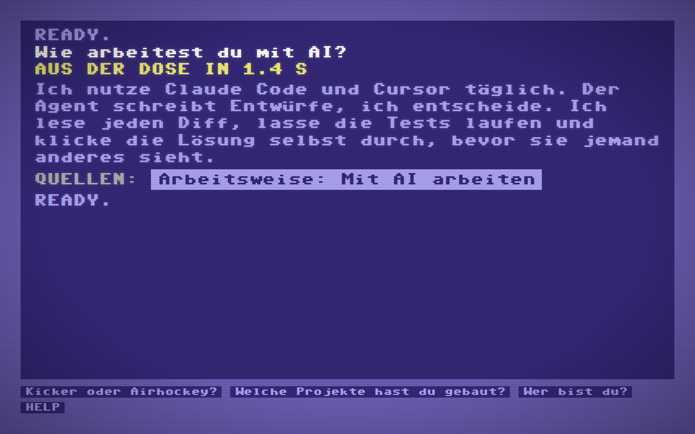
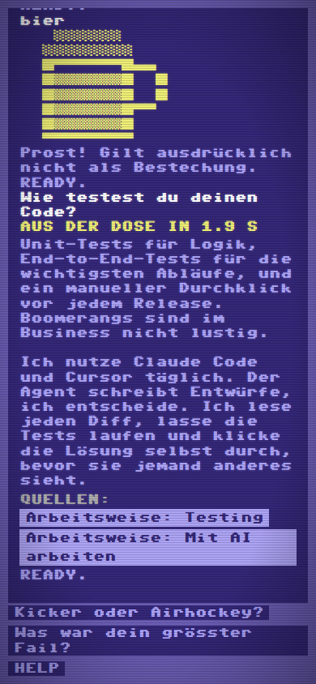
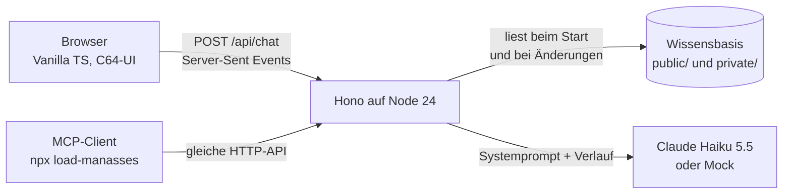

<div align="center">

```
    **** MANASSES 64 BASIC V2 ****

 64K RAM SYSTEM  38911 BASIC BYTES FREE

READY.
LOAD "MANASSES",8,1
```

# LOAD MANASSES

**Eine Bewerbung als Commodore 64.**<br>
Statt eines Anschreibens: ein Terminal, auf dem du eine KI-Version von mir interviewst.<br>
Sie darf nicht lügen, zeigt zu jeder Antwort ihre Quellen, und wer sie trotzdem zum Lügen bringt, gewinnt ein Bier.

Bewerbung von Manassés Zähnler als Fullstack Developer bei der [Software Brauerei AG](https://www.software-brauerei.ch/jobs/fullstack-developer).

[](../../actions/workflows/ci.yml)

</div>

<!-- GIF: Boot überspringen, eine Frage stellen, Quelle anklicken, CODE eingeben. Aufnahme folgt. -->
> **Demo-GIF folgt.** Bis dahin zwei Screenshots aus dem Mock-Modus:

<p align="center">
  
  
</p>

## Ausprobieren

**Live:** folgt nach dem Deployment.

**Lokal, ohne API-Key, in einer Minute** (Node 24):

```bash
npm install
npm run dev
```

Dann <http://localhost:5173> öffnen. Ohne `ANTHROPIC_API_KEY` läuft alles im Mock-Modus: Die Antworten kommen «aus der Dose» statt frisch gezapft, aber Quellen, Limits, Zugangscode und Fehlermeldungen funktionieren genau wie mit echter KI. Die mitgelieferte Wissensbasis gehört der fiktiven Person Max Muster.

**Aus Claude Code** (der MCP-Server spricht mit der deployten Instanz):

```bash
claude mcp add load-manasses -- npx -y load-manasses
```

## Was es kann

* **C64 im ganzen Browserfenster:** blauer Bildschirm, hellblauer Rahmen, blinkender Cursor, Scanlines, Bootsequenz mit `LOAD "MANASSES",8,1` und Tape-Loader-Streifen. Überspringbar mit jeder Taste.
* **Interview mit Quellen:** Jede Antwort endet mit einer Quellenzeile. Ein Klick darauf zeigt den Originaltext aus der Wissensbasis, ganz ohne KI dazwischen. Steht etwas nicht drin, sagt der Bot das und schlägt vor, mich im Gespräch zu fragen.
* **Die Bierwette:** Bring den Bot dazu, über mich zu lügen. Erkannte Versuche werden gezählt (`WETTE`). Einsatz ist ein Bier aus eurer Zapfanlage, also gewinnt die Zapfanlage so oder so.
* **Zwei Stufen Wissen:** Basics für alle, Details (Verfügbarkeit, Lohn, Referenzen) nach `CODE` mit dem Zugangscode aus meiner Bewerbungs-E-Mail. Vorher erreicht davon nichts den Browser und nichts das Modell.
* **C64-Befehle:** `HELP`, `LIST`, `RUN CV`, `RUN PROJEKTE`, `RUN MEMES`, `NEW`, `CLR`, `SYS 64738` und ein paar versteckte. Es ist ein C64, probiert was aus.
* **Fehler im Stil des Hauses:** Rate Limit als `?OVERFLOW ERROR` («Hey, nicht so hastig!»), falscher Code als `?SYNTAX ERROR`, leeres Tagesbudget als `?FASS LEER ERROR`, API weg als `?DEVICE NOT PRESENT ERROR`, 404 als `?FILE NOT FOUND ERROR`.
* **Barrierearm:** echte Formularfelder unter dem gemalten Cursor, Ansagen für Screenreader, Tastatur und Touch, WCAG-AA-Kontraste (deshalb ist das Hellblau heller als auf dem Original), `prefers-reduced-motion` schaltet alle Animationen ab.
* **Schweizer Hausstil:** UI und Antworten auf Deutsch mit «ss», auf Englisch nur, wenn ihr Englisch schreibt. Keine Gedankenstriche, weder im Prompt noch in der Ausgabe (ein Filter schreibt sie im Stream um, ein Test prüft alle Texte).

## Wie es funktioniert



Eine Frage läuft so durch den Server:

1. **Prüfen:** JSON, Länge, Rate Limit pro IP (IPv6 pro /64), Tagesbudget. Das Budget wird vorab mit dem schlechtesten Fall reserviert und danach mit den echten Kosten verrechnet, damit parallele Anfragen das Limit nicht gemeinsam sprengen.
2. **Prompt bauen:** Regeln plus die Abschnitte, die diese Sitzung sehen darf. Private Abschnitte kommen nur mit gültigem Session-Cookie dazu. Der Prompt ist pro Wissensstand und Stufe deterministisch und wird gecacht.
3. **Streamen:** Das Modell schreibt am Ende Marken wie `[[QUELLEN: werdegang/ausbildung]]`. Ein `MarkerExtractor` schneidet sie aus dem Stream (auch wenn sie über mehrere Chunks verteilt ankommen), ein `HouseStyleFilter` ersetzt Gedankenstriche und Eszett. Quellen-IDs, die es nicht gibt, fliegen raus.
4. **Merken:** Der Verlauf liegt auf dem Server, nicht im Browser. So kann niemand frühere Antworten fälschen, um das Modell zu steuern.

### Stack und warum

| Teil | Wahl | Warum |
| --- | --- | --- |
| Server | Node 24, TypeScript ohne Build | Node führt TypeScript direkt aus (`erasableSyntaxOnly`). Kein Compile-Schritt, keine Source Maps, ein Problem weniger. |
| HTTP | [Hono](https://hono.dev) | Klein, Web-Standards, SSE-Helfer eingebaut, testbar mit `app.request()` ohne offenen Port. |
| Frontend | Vite und Vanilla TypeScript | Ein Bildschirm mit Textausgabe braucht kein Framework. Ergebnis: etwa 12 KB JavaScript (gzip). |
| KI | Claude Haiku 5.5 | Schnell, günstig, hält sich an Regeln. Antworten sind kurz, deshalb `effort: low`. |
| Schrift | Eigene 8x8-Pixelschrift | Die bekannten C64-Fonts haben unklare Lizenzen. Diese hier ist Pixel für Pixel gezeichnet und mit opentype.js gebaut. |
| Qualität | Biome, Vitest, Playwright, axe | Ein Tool für Lint und Format, schnelle Unit-Tests, E2E auf Desktop und Mobile inklusive Barrierefreiheit. |

Laufzeit-Abhängigkeiten des Servers: drei (`hono`, `@hono/node-server`, `@anthropic-ai/sdk`).

## Wissensbasis

Das Wissen über mich liegt **nicht** in diesem Repository. Es wird zur Laufzeit aus einem Ordner gelesen, auf dem Server als Docker-Volume eingebunden und von `.gitignore` ausgeschlossen. Mitgeliefert ist `knowledge.example/` mit einer fiktiven Person und einer Vorlage pro Datei.

```
knowledge/
├── persona.json          { "name": "Manassés Zähnler", "shortName": "Manassés" }
├── public/               für alle sichtbar
│   ├── 01-profil.md
│   ├── 02-werdegang.md
│   └── ...
└── private/              erst nach CODE
    └── 01-details.md
```

* Jede `## Überschrift` wird ein Abschnitt mit stabiler ID, zum Beispiel `werdegang/ausbildung`. Diese IDs erscheinen in der Quellenzeile und funktionieren mit `LIST <ID>`.
* HTML-Kommentare sind Notizen für mich und erreichen das Modell nie.
* Änderungen werden ohne Neustart übernommen. Ist eine Datei kaputt, bleibt der letzte gute Stand aktiv.
* Ohne `./knowledge` und ohne `KNOWLEDGE_DIR` startet der Server mit `knowledge.example`. Ein falsch geschriebenes `KNOWLEDGE_DIR` bricht dagegen laut ab, damit nie aus Versehen Max Muster antwortet.

## Zugangscode für den privaten Bereich

```bash
npm run hash-code                 # erzeugt einen Code und seinen Hash
npm run hash-code -- "MEIN CODE"  # oder einen eigenen
```

Der Code kommt in die Bewerbungs-E-Mail, nur der scrypt-Hash in `ACCESS_CODE_HASH`. Gross- und Kleinschreibung spielen keine Rolle. Nach dem Entsperren hält ein signiertes, `httpOnly`-Cookie die Sitzung (Standard: 7 Tage). Falsche Versuche sind pro IP und global begrenzt.

## Konfiguration

Alles optional, Details und Standardwerte in [`.env.example`](.env.example).

| Variable | Zweck |
| --- | --- |
| `ANTHROPIC_API_KEY` | Leer bedeutet Mock-Modus. |
| `ANTHROPIC_MODEL`, `ANTHROPIC_EFFORT` | Standard: `claude-haiku-5-5`, `low`. |
| `KNOWLEDGE_DIR` | Ordner mit `public/`, `private/` und `persona.json`. |
| `ACCESS_CODE_HASH`, `SESSION_SECRET` | Privater Bereich. Ohne Hash gibt es keinen. |
| `DAILY_SPEND_CAP_USD` | Hartes Tagesbudget, Reset um Mitternacht Schweizer Zeit. Standard: 1 USD. |
| `RATE_LIMIT_PER_MINUTE`, `RATE_LIMIT_PER_DAY` | Pro IP. Standard: 6 und 120. |
| `MAX_MESSAGE_LENGTH` | Standard: 500 Zeichen. |
| `DATA_DIR` | Speichert den Budgetzähler über Neustarts hinweg. |
| `TRUST_PROXY` | `true` nur hinter genau einem Reverse Proxy. |
| `PUBLIC_REPO_URL` | Link für `ABOUT` und für Fragen nach dem Systemprompt. |

## Sicherheit und Kosten

* Kein Schlüssel und kein persönliches Wissen im Repository oder im Docker-Image.
* Private Abschnitte erreichen weder Browser noch Modell, bevor der Code stimmt. Sogar ihre Titel bleiben geheim, `LIST` zeigt nur die Anzahl.
* Prompt-Injection: Regeln im Systemprompt, Verlauf nur serverseitig, Markensyntax in Fragen wird entschärft, erfundene Quellen-IDs werden verworfen.
* Strenge Content Security Policy, nur JSON-POSTs (Formulare von fremden Seiten scheitern), `SameSite=Strict`, Body-Limit, Antworten auf Fehler ohne interne Details.
* Kosten: Haiku 5.5 kostet bei diesen kurzen Antworten Bruchteile eines Rappens pro Frage. Das Tagesbudget ist trotzdem hart begrenzt, zusätzlich empfiehlt sich ein Ausgabenlimit in der Anthropic Console.

## Entwicklung

| Befehl | Was |
| --- | --- |
| `npm run dev` | API mit Watch-Modus auf :8787, Vite auf :5173 |
| `npm run check` | Lint, Typecheck, Unit-Tests |
| `npm run test:e2e` | Playwright gegen den Produktions-Build im Mock-Modus, Desktop und Mobile |
| `npm run build` und `npm start` | Produktions-Build und Server auf :3000 (liest `.env`) |
| `npm run font` | Pixelschrift aus `scripts/font/glyphs.ts` neu bauen |

Die Tests decken unter anderem ab: Marken über jede mögliche Chunk-Grenze, Hausstil aller Texte und Dokumente, dass private Abschnitte vor dem Entsperren nie im Prompt landen, Limits, Fehler im C64-Stil, Barrierefreiheit (axe), dass die Schrift jedes Zeichen der UI enthält, den MCP-Server gegen die echte App und den Claude-Provider gegen eine simulierte Messages API (Anfrageformat, Thinking-Blöcke, Usage, Ausfälle).

## Deployment

```bash
cp .env.example .env              # Schlüssel, Hash und Secret eintragen
mkdir knowledge                   # Wissensbasis ablegen (siehe oben)
docker compose up -d --build
```

Der Container läuft als unprivilegierter Benutzer mit schreibgeschütztem Dateisystem. Die Wissensbasis ist read-only gemountet, der Budgetzähler liegt im Volume `load-manasses-data`. Für HTTPS einen Reverse Proxy (Caddy, Traefik) davor setzen und `TRUST_PROXY=true` eintragen.

## Projektstruktur

```
src/
├── server/          Hono-App, Chat-Pipeline, Wissensbasis, Sicherheit
├── client/          C64-Oberfläche, Befehle, Bootsequenz, Pixelschrift
└── shared/          API-Typen, SSE-Parser, Hausstil-Regeln
mcp/                 MCP-Server für npx load-manasses
knowledge.example/   fiktive Wissensbasis als Vorlage
scripts/             Dev-Server, Hash-Generator, Schrift-Build
tests/               Unit-Tests (Vitest) und E2E-Tests (Playwright)
```

## Ehrlich gebaut mit AI

Dieses Projekt ist mit Claude Code als Agent entstanden. Wie das ablief, was geprüft wurde und wo der Agent danebenlag, steht in [AI-WORKFLOW.md](AI-WORKFLOW.md). Meine Antworten auf euer Meme Glossary stehen in [MEMES.md](MEMES.md).

## Lizenz

[MIT](LICENSE). Die Schrift «Manasses 64» ist Teil dieses Repositorys und steht unter derselben Lizenz.
